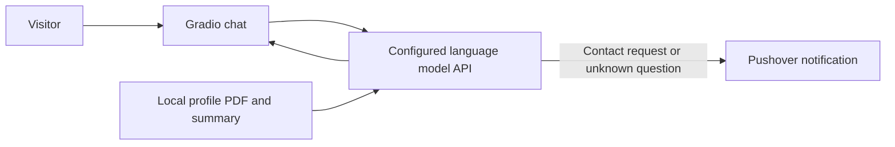

# Digital Twin AI Agent

A conversational AI digital twin that answers questions about a person's career, skills, and experience. Built with Python and Gradio, it connects to a configurable language-model API and grounds responses in locally supplied profile information. The API must support the OpenAI Chat Completions interface and tool calling; configure its endpoint, API key, and model in `.env`.

The chat can also capture a visitor's contact details and flag questions the twin cannot answer, sending those notifications through Pushover.

## Features

- Career-focused chat interface with suggested questions
- API-powered responses grounded in a LinkedIn profile PDF and a short personal summary
- Function calling to record contact requests and unanswered questions
- Gradio interface with custom styling
- Private profile files and environment secrets excluded from Git

## How It Works



## Requirements

- Python 3
- Credentials for a language-model API that supports OpenAI-compatible Chat Completions and tool calling
- A Pushover account and application token for notifications

## Run Locally

1. Clone the repository and move into its directory.

   ```bash
   git clone https://github.com/<your-username>/digital_twin_AI_agent.git
   cd digital_twin_AI_agent
   ```

2. Create and activate a virtual environment.

   ```bash
   python3 -m venv .venv
   source .venv/bin/activate
   ```

3. Install the dependencies and create your local environment file.

   ```bash
   python -m pip install -r requirements.txt
   cp .env.example .env
   ```

4. Add your profile files to the project root:

   - `linkedin.pdf`: PDF containing the profile information used for grounding
   - `summary.txt`: short summary of the person represented by the twin

5. Set the values in `.env`:

   ```dotenv
   LLM_API_KEY=your_api_key
   LLM_BASE_URL=https://your-provider.example/v1
   LLM_MODEL=your-model-name
   PUSHOVER_USER=your_pushover_user_key
   PUSHOVER_TOKEN=your_pushover_api_token
   ```

6. Start the app.

   ```bash
   python app.py
   ```

   Open the local URL printed by Gradio in your browser.

## Configuration Notes

Set `LLM_BASE_URL`, `LLM_API_KEY`, and `LLM_MODEL` to match your API provider. The provider must implement the OpenAI Chat Completions interface, including tool calling. Pushover credentials are used by the contact-request and unanswered-question tools.

`linkedin.pdf`, `summary.txt`, and `.env` are intentionally ignored by Git. Add your own profile files locally; do not commit personal information, API keys, or notification tokens.

## Tech Stack

- Python
- Gradio
- OpenAI Python client for compatible language-model APIs
- PyPDF for extracting profile text
- Pushover for notifications

## Project Structure

| File | Purpose |
| --- | --- |
| `app.py` | Gradio interface and model conversation loop |
| `context.py` | Loads profile data and defines the digital twin's instructions |
| `tools.py` | Handles contact and unanswered-question notifications |
| `styles.py` | Chat examples and custom interface styling |
| `requirements.txt` | Python dependencies |
| `.env.example` | Environment variable template |

## License

No license is currently specified. Add a license before encouraging reuse of this project.

## Author

Created by **Gourab Chakraborty**, AI Automation Engineer.